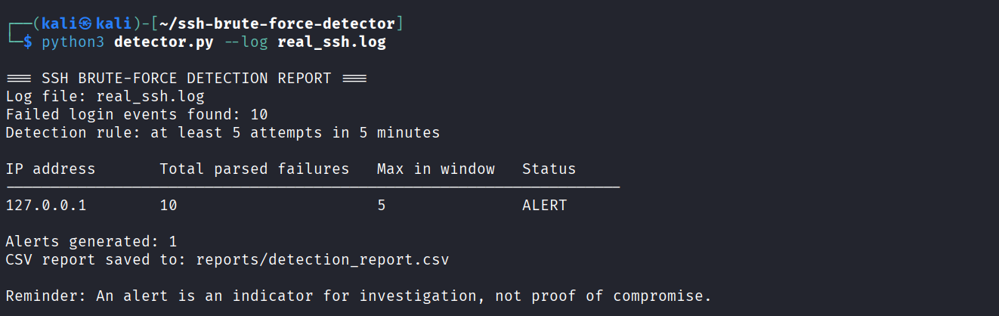

# SSH Brute-Force Detection Tool

A defensive Python-based cybersecurity project that analyzes Linux SSH authentication logs, identifies repeated failed login attempts, detects suspicious activity based on configurable thresholds, and generates CSV reports.

The project was developed and tested in a Kali Linux virtual machine using real SSH authentication events generated in a controlled local lab environment.

## Project Objectives

- Understand Linux SSH authentication logs.
- Identify repeated failed login attempts.
- Extract and validate source IP addresses.
- Detect suspicious login activity using a time-based threshold.
- Generate reports to support security investigation.

## Features

- Parses common Linux SSH failed-password log entries.
- Supports traditional syslog-formatted authentication logs and tested Kali journal-exported logs.
- Extracts and validates IPv4 addresses.
- Counts failed login attempts by source IP.
- Detects repeated failures within a configurable time window.
- Generates console alerts and CSV reports.
- Includes synthetic sample logs for safe testing.
- Uses Python's standard library without external dependencies.

## Technologies Used

- Python 3
- Kali Linux
- Linux SSH / OpenSSH
- journalctl
- Regular Expressions
- CSV
- VMware Workstation
- Git and GitHub

## Project Structure

```text
ssh-brute-force-detector/
├── .gitignore
├── detector.py
├── sample_auth.log
├── requirements.txt
├── README.md
├── ssh-brute-force-detection.png
└── reports/
    └── .gitkeep
```

**Note:** Real authentication logs, local backup files, and generated CSV reports from local testing are excluded from the public repository because they may contain sensitive information.

## Requirements

- Python 3.10 or newer
- Linux, Windows, or macOS
- Kali Linux recommended for the SSH journal testing workflow

No third-party Python packages are required.

## Installation

Clone the repository:

```bash
git clone https://github.com/LiyakhathAliShaik/ssh-brute-force-detector.git
cd ssh-brute-force-detector
```

Run the detector using sample data:

```bash
python3 detector.py
```

## Testing with Kali Linux SSH Logs

The project was tested using SSH authentication events generated against the local Kali Linux machine.

### Step 1: Start the SSH service

```bash
sudo systemctl start ssh
```

### Step 2: Generate a controlled failed login

```bash
ssh invaliduser@127.0.0.1
```

Enter an incorrect password and observe the authentication failure.

### Step 3: Capture failed SSH login events

```bash
sudo journalctl --since today --no-pager | grep -E 'Failed password' > real_ssh.log
```

### Step 4: Run the detector

```bash
python3 detector.py --log real_ssh.log
```

The detector processes the log entries, extracts timestamps and source IP addresses, and checks whether the configured detection threshold has been reached.

**Safety:** Only perform testing on systems you own or are authorized to access.

## Detection Configuration

The detector supports configurable detection parameters:

| Argument | Description | Default |
|---|---|---|
| `--log` | Authentication log path | `sample_auth.log` |
| `--threshold` | Failed attempts required for an alert | 5 |
| `--window` | Detection time window in minutes | 5 |
| `--year` | Year used for syslog timestamps | Current year |
| `--csv` | CSV report output path | `reports/detection_report.csv` |

Example:

```bash
python3 detector.py --log real_ssh.log --threshold 5 --window 5
```

## Detection Results

During the controlled Kali Linux lab test:

- Total failed login events captured: 10
- Source IP address: 127.0.0.1
- Detection threshold: 5 attempts
- Time window: 5 minutes
- Maximum attempts within the window: 5
- Alerts generated: 1

The detector successfully identified repeated failed SSH authentication attempts from the same source IP.

## Detection Screenshot

The following screenshot shows the successful execution of the detector and the generated alert.



## CSV Reporting

The detector automatically generates a CSV report containing:

- Source IP address
- Total failed login attempts
- Maximum failed attempts within the configured time window
- Alert status

The generated report is saved at:

```text
reports/detection_report.csv
```

Generated CSV reports are excluded from the public repository to avoid publishing local testing data.

## Detection Logic

An alert is generated when a single source IP address reaches or exceeds the configured number of timestamped failed SSH password attempts within the specified time window.

This is a basic detection heuristic. Repeated failed authentication attempts may indicate suspicious activity, but an alert alone does not confirm a successful attack or system compromise.

## Limitations and Future Improvements

1. Add IPv6 address support.
2. Improve timestamp and timezone handling.
3. Add automated unit tests.
4. Support additional SSH authentication log formats.
5. Add JSON report generation.
6. Develop a dashboard for visualizing suspicious login activity.
7. Explore SIEM integration.

## Resume Description

**SSH Brute-Force Detection Tool | Python, Kali Linux, Linux Logs**

- Developed a Python-based defensive tool to analyze SSH authentication logs, extract source IP addresses, and identify repeated failed login attempts.
- Implemented configurable time-window detection and CSV reporting to generate alerts for suspicious authentication activity.
- Tested the detection workflow using real SSH authentication events in a controlled Kali Linux lab environment.

## Safety and Privacy

This project is designed for defensive security monitoring and educational purposes.

- Analyze only systems and logs you own or are authorized to access.
- Do not publish real authentication logs containing usernames, IP addresses, or infrastructure details.
- The tool performs read-only log analysis and does not block IP addresses or modify firewall configurations.
- Detection alerts should be investigated rather than treated as proof of compromise.
